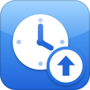

# Send Later

Schedule texts in iOS 6 Messages: touch and hold Send, pick a time, and the iPhone sends it then, even with Messages closed.

## Features

- Touch and hold Send to schedule what you typed, with a stock-style date and time picker.
- Sends at that time even when Messages is closed or the phone is asleep: SpringBoard wakes the phone and sends it.
- Touch and hold Send again to see what's scheduled in that conversation, then send it now, change the time or delete it.
- Works for iMessage, SMS and group chats. A message that can't go out stays in the list as Not Sent, and you get an alert.

## How to use

1. In a conversation, type your message, then touch and hold Send.
2. Tap Send Later…, pick a time and tap Schedule.
3. To see, change or cancel it, touch and hold Send again and tap Scheduled Messages.

## Requirements

- Jailbroken iOS 6 (tested on an iPhone 5 with iOS 6.1.2)
- Cydia Substrate (Cydia installs them for you)

## Install

In Cydia, add `https://mbucc9000.github.io/slopkit/` and install **Send Later**. Or download the `.deb` from [Releases](../../releases) and install it with `dpkg -i`.

## Building

[Theos](https://theos.dev) with the iOS 6.1 SDK: `make package FINALPACKAGE=1`.

## License

MIT.
